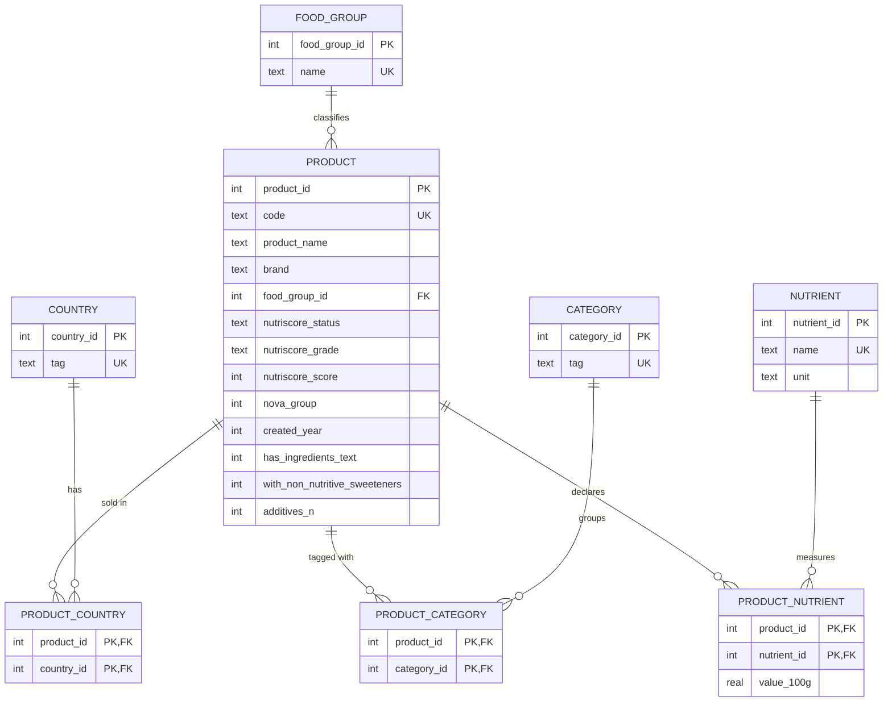

# Реляционная схема SQLite и аналитические запросы

Схема — [`sql/schema.sql`](../sql/schema.sql), индексы — [`sql/indexes.sql`](../sql/indexes.sql),
загрузчик — `src/offna/database.py` (`make sql`). База строится из партиционированного
Parquet потоково, по одному файлу партиции, поэтому пик RSS на полном снимке — 1,3 ГБ.

## ER-диаграмма

Решения по нормализации:

- Страны и категории — связи many-to-many, поэтому вынесены в таблицы связей.
  Страна в Open Food Facts — **страна продаж**, а не производства.
- Нутриенты хранятся в длинном формате (`product_nutrient`): 9 показателей на 100 г,
  только непустые неотрицательные значения. Пропуск — это отсутствие строки, а не ноль.
- Дубликаты `code` (61 код, 122 строки) схлопываются до последней версии по `last_modified_at`.
- `nutriscore_grade` хранит только валидные a–e; `unknown`/`not-applicable` — в `nutriscore_status`.

## Объём на полном снимке

| Таблица | Строк |
| --- | ---: |
| product | 4 906 806 |
| product_country | 5 172 813 |
| product_category | 10 806 905 |
| product_nutrient | 28 909 738 |
| category | 124 648 |
| country | 501 |
| food_group | 12 |
| nutrient | 9 |

Файл БД — 1,6 ГБ, загрузка — 87 с.

## Запросы

Все запросы выполняются через `pandas.read_sql_query`; результаты полного прогона —
в [`docs/results/tables`](results/tables).

| Файл | Что показывает | Конструкции | Время, с |
| --- | --- | --- | ---: |
| `q01_products_by_country.sql` | Продукты, доля с Nutri-Score и с текстом состава по странам | JOIN ×2, GROUP BY, HAVING | 1,8 |
| `q02_grade_share_by_country.sql` | Распределение A–E в 10 крупнейших странах | CTE ×2, оконная `SUM() OVER (PARTITION BY)` | 3,6 |
| `q03_sugar_rank_categories.sql` | Топ-3 категорий по среднему сахару внутри каждой пищевой группы | CTE ×3, JOIN ×4, HAVING, `RANK() OVER` | 6,1 |
| `q04_completeness_country_food_group.sql` | Полнота 8 нутриентов: страна × группа, только однострановые продукты (H1) | CTE, LEFT JOIN, HAVING | 5,7 |
| `q05_sweeteners_sugar.sql` | Сахар и доля A/B с подсластителями и без (H2) | JOIN ×3, GROUP BY, HAVING | 1,2 |
| `q06_products_per_year_running.sql` | Рост базы по годам, накопительный итог | CTE, `SUM() OVER (ORDER BY)`, `LAG()` | 0,7 |
| `q07_salt_above_group_average.sql` | Доля продуктов с солью выше среднего своей группы | CTE ×2, скалярный подзапрос, `IN (SELECT …)` | 2,4 |
| `q08_multi_country_products.sql` | Продукты, продаваемые в 3+ странах, по группам | CTE, JOIN, HAVING | 1,3 |
| `q09_salt_quartile_grades.sql` | Распределение грейдов по квартилям соли | `NTILE(4) OVER`, оконная доля | 2,0 |
| `q10_nova_vs_grade.sql` | NOVA × Nutri-Score | `SUM() OVER`, `DENSE_RANK() OVER` | 0,4 |

Как результаты используются в анализе — см. [отчёт](REPORT.md#sql-и-выводы).
