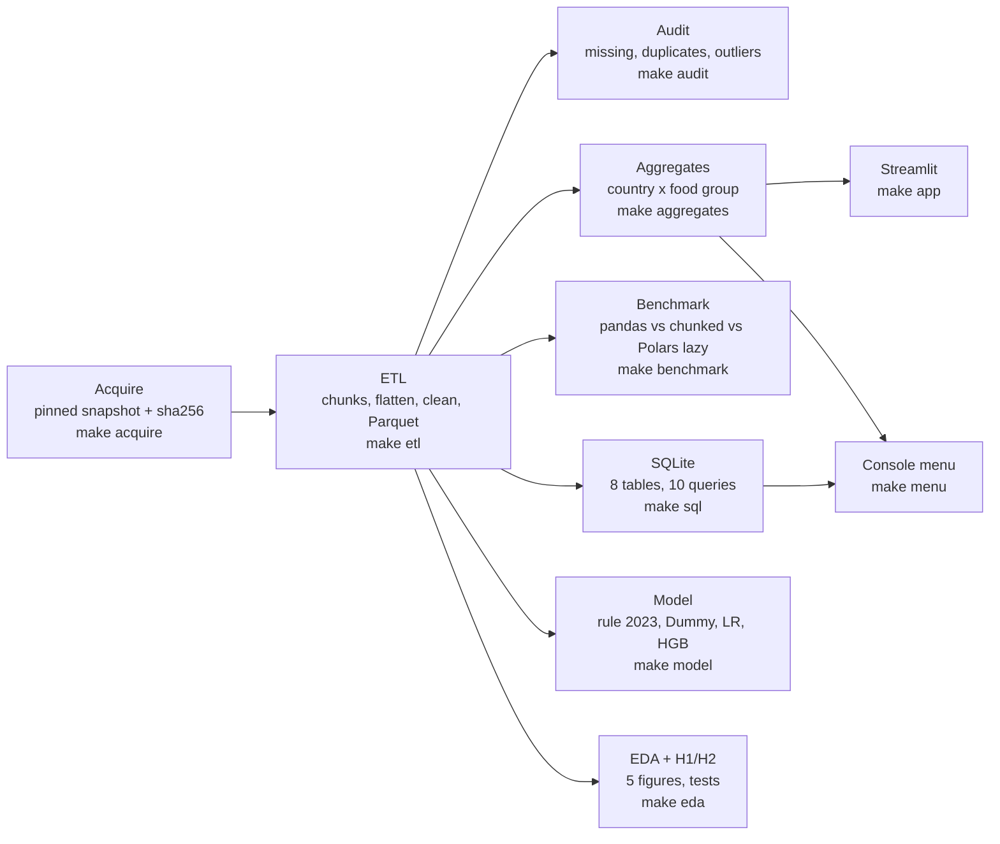

# Defence study guide: Open Food Facts nutrition analytics

For a team member who must defend the project orally. Project: final project No. 43, group AAI-2606M, course "Programming for Data Analysis and Database", cluster 8 (Large-Scale Data Processing). Team: Lukoyanov, Ozhetov, Amantay.

**Who presents what: _TBD_ by team.** The assessment rules say every member must be able to explain any part of the code, so read all of it, not only your block.

How to use this guide. Part 0 builds the mental models from zero and traces one real product through the whole pipeline. Parts 1 to 3 are the defence material, step by step. Parts 4 to 8 are the rubric map, honest limitations, glossary, rapid-fire questions and the checklist for the day. Do not memorise sentences. Read a step, close the file, and explain it in your own words to an imaginary classmate. If you cannot, reread the "analogy" paragraph of that step.

Source tags used below: numbers come from `docs/results/*.json` and `docs/results/tables/*.csv` (the full run on the 4.9 million product snapshot), from `docs/REPORT.md` where it quotes them, or from a command I ran fresh while writing (marked "fresh run"). Where I could not verify something, the text says so.

Fresh run while writing this guide (clean worktree, fixture data): `make setup`, `make pipeline` (about 50 seconds wall time on a cold start, 18 s warm), `make test` (53 passed in 3.73 s), `make lint` (ruff check: all checks passed; ruff format: 45 files already formatted), `make slides`. I did not run the full 7.5 GiB pipeline, `make acquire`, `make csv-audit`, `make app` or `make menu`; the full-run numbers are the committed results.

---

# Part 0. From zero

## 0.1 The core concepts, with analogies and real numbers

**DataFrame.** A table in memory with named columns, like an Excel sheet that code can filter and aggregate. Pandas and Polars are two libraries that provide it. Our snapshot is one table with 4,906,869 rows (products) [full_snapshot.json]. One row is one product; the column `code` is the barcode.

**CSV versus Parquet.** CSV is a text file: every value is stored as characters, one row per line, and a reader has to guess what is a number. Parquet is a binary column store: the file knows the type of every column and stores each column's values together, compressed. Analogy: CSV is a stack of paper forms; Parquet is a warehouse where all the "sugar" values are on one shelf, so if you only need sugar you walk to one shelf. That is why we can read 26 of 111 columns without touching the rest. The same snapshot is 7.49 GiB as Parquet [full_snapshot.json: 8,045,833,255 bytes]; the cleaned partitioned version we write is about 264 MB with zstd compression [REPORT section 2].

**Lazy evaluation.** Eager code does each step immediately and keeps the result. Lazy code first writes down a plan ("read these columns, filter, group, average") and executes it only when you ask for the result, so the engine can skip work and process in pieces. Analogy: eager is cooking each dish as the customer lists it; lazy is hearing the full order first and then cooking everything in one efficient pass. In Polars: `scan_parquet(...)` builds the plan, `.collect()` runs it.

**Memory and peak RSS.** RSS (resident set size) is how much physical RAM a process holds. Peak RSS is the highest it ever reached. That is what makes a laptop run out of memory, so it is the number that matters for "data larger than memory". Do not confuse it with the size of a DataFrame (`memory_usage`), which is only the table, not the interpreter, buffers and temporary copies. Our full ETL peaked at 3,582 MiB [etl_report.json] on a 24 GB machine while the file is 7.49 GiB, so the data never sat in memory at once.

**Normalised database.** Instead of one giant table with repeated text ("en:france" written five million times), you split by meaning: one table of products, one of countries, and a small link table saying which product is sold in which country. Analogy: a library keeps one card per book and one card per author, and a third list "book X is by author Y"; it does not rewrite the author's biography on every book card. Our SQLite database has 8 tables, for example `product` (4,906,806 rows), `country` (501 rows), `product_country` (5,172,813 rows) [sql_report.json].

**JOIN.** The operation that glues those tables back together on a shared key at query time. Analogy: follow the "book X is by author Y" list to fetch the author's card. Example from `q01_products_by_country.sql`: `product` joined to `product_country` on `product_id`, then to `country` on `country_id`.

**Classification.** Predict a category from numbers. Here: from the nutrition facts of a product, predict the Nutri-Score letter A, B, C, D or E. Analogy: a doctor who sees only temperature and blood pressure and must say "healthy / mild / severe".

**Train/test split.** Cut the labelled data into a study set (train) and an exam set (test). The model learns on train and is graded on test, which it has never seen. Analogy: a student who memorised last year's exam answers scores 100% on that exam but proves nothing. Ours: 1,149,247 train rows and 287,815 test rows [model_report.json].

**Data leakage (утечка данных).** Any way the answer sneaks into the exam preparation. Two kinds matter here. First, leakage through features: giving the model the Nutri-Score points or letter itself. We prevent it with a feature allowlist and a test. Second, leakage through the split: the same product appears in train and test under slightly different records, so the model "recognises" instead of "reasoning". We prevent it by splitting by group of identical products, not by row.

**F1 and macro-F1.** Accuracy is "share of correct answers", which looks good when one class dominates. F1 for one class combines precision (of everything I called B, how many were B) and recall (of all real B, how many did I find) into one number: F1 = 2 x precision x recall / (precision + recall). Macro-F1 is the plain average of the five class F1 values, so every grade counts equally. Worked example from the rule's confusion matrix [confusion_rule_2023.csv]: class B has 28,466 correct, 32,802 real B in total (recall 0.868) and 30,841 predicted B (precision 0.923). F1 = 0.8946, which is exactly the B value in `model_report.json`. The dumb baseline "always predict E" has accuracy 0.274 but macro-F1 only 0.086, because F1 for A, B, C, D is zero. That gap is why macro-F1 is our main metric.

**p-value.** A test starts from the sceptical assumption "there is no difference" and asks: if that were true, how surprising is the data we saw? The p-value is that surprise probability. Small p (below 0.05) means "hard to explain by chance". It does not say the difference is large or important. With millions of rows everything is "significant", which is why we also report an effect size (Cramér's V, median difference) and require it to be big enough. In our CSV tables some p-values print as `0.0`; that is floating-point underflow (smaller than the smallest number the computer can store), not literally zero.

## 0.2 Map of the project files

Pipeline code is the Python package `offna` in `src/offna/`, started through `make` targets that call `offna.cli`.

- `config.py`: pinned revision and sha256, seed 43, the list of 26 raw columns, nutrient name mapping, profiles `demo` and `full`.
- `acquire.py`: download, checksum, snapshot passport, fixture builder.
- `csv_reader.py`, `csv_audit.py`: the careful TSV parser and its comparison with naive `pd.read_csv`.
- `etl.py`, `categories.py`: flatten, harmonise units, derive columns, clean, write partitioned Parquet; category flags used by the Nutri-Score rule.
- `audit.py`: missingness, duplicates, outliers, dates.
- `engines.py`, `benchmark.py`, `bench_worker.py`, `measure.py`: the three engines, the isolated-process benchmark, time and RSS helpers.
- `aggregates.py`: small precomputed tables for the dashboard.
- `database.py` plus `sql/`: SQLite schema, loader, 10 queries.
- `nutriscore.py`: the Nutri-Score 2023 and 2021 rules. `model.py`: split, features, models, metrics.
- `eda.py`, `hypotheses.py`: figures and tests of H1 and H2.
- `app.py`, `dashboard.py`, `menu.py`: Streamlit and the console menu.
- `cli.py`: stage dispatcher. `slides.py`: builds `docs/slides.pptx`.
- `tests/`: pytest; `tests/fixtures/off_sample.parquet` is the committed 10,000-product sample.
- `docs/`: report, slides plan, database doc, rubric map, results.

Two profiles exist. `demo` uses the committed 10,000-row fixture and works offline in about a minute. `full` uses the real 4.9 million row snapshot, which is not in Git. Always say which profile a number comes from. For example, on the fixture H1 and H2 print "not testable: too few products" [fresh run, `outputs/demo/reports/eda_report.json`], and the demo model scores are lower than the full run (HGB macro-F1 0.800 on the fixture versus 0.930 full). If you demo on the fixture, do not quote report numbers from it.

## 0.3 Minimal syntax to read the code

Python basics used everywhere: a `dict` maps names to values (`NUTRIENTS = {"energy-kj": "energy_kj_declared_100g", ...}` renames source names to our names); a list comprehension builds a list in one line (`[name for name in names if cond]`); an f-string inserts values (`f"{count:,}"` prints 4,906,869 with commas); `with open(...) as f` opens a file and closes it even on error; `try ... except FileNotFoundError` handles a missing file; `yield` makes a function return pieces one at a time (a generator), which is how we read a huge file chunk by chunk.

Pandas: `df[df["sugars_100g"] > 5]` keeps rows matching a condition; `df.groupby("country")["products"].sum()` is "sum per country"; `df["x"].isna()` marks missing values; `pd.crosstab(a, b)` counts combinations of two columns; `pd.read_sql_query(sql, connection)` runs SQL and returns a DataFrame.

Polars: columns are expressions. `pl.col("sugars_100g").is_null().mean()` is "share of missing sugar"; `df.with_columns(...)` adds columns; `pl.when(cond).then(a).otherwise(b)` is if/else per row; `.explode("countries_tags")` turns a list column into one row per list element; `.group_by("country").agg(pl.len())` is group and count; `pl.scan_parquet(path)` is lazy, `.collect()` runs.

SQL: `SELECT columns FROM table JOIN other ON key WHERE row_filter GROUP BY column HAVING group_filter ORDER BY column LIMIT n`. WHERE filters rows before grouping; HAVING filters groups after.

## 0.4 One real product through the whole pipeline

Product: "Pain de mie Sans Croûte Nature (21 tranches)", brand Leader Price, barcode `3263859760519`, from `tests/fixtures/off_sample.parquet`. I picked it because it is plain food (not a drink, cheese, fat or red meat), has complete data, and shows the 2021 versus 2023 difference. Everything below was computed by me with the project code on the fixture (fresh run) unless marked otherwise.

**1. Raw row.** The fixture keeps 26 of the 111 columns. Relevant raw values: `brands` = "Leader Price, Groupe Casino"; `countries_tags` = ["en:france"]; `food_groups_tags` = ["en:cereals-and-potatoes", "en:bread"]; `nutriscore_grade` = "c", `nutriscore_score` = 7; `ingredients_n` = 16; `with_non_nutritive_sweeteners` = None; `created_t` = 1388425064 (seconds since 1970). `product_name` is a list of language records, not a string. `nutriments` is a list of 15 records, each with a name and fields such as `100g`; 13 of those names are ones we map, for example `energy-kj` 1029, `energy-kcal` 246, `sugars` 6.9, `saturated-fat` 0.4, `salt` 1.05, `sodium` 0.42, `fiber` 2.4, `proteins` 7.9, `fat` 2.9, `carbohydrates` 45.2, `fruits-vegetables-legumes` 0.0.

**2. Cleaned row** (after `etl.py`). Nutrients are flat columns: `energy_kj_100g` 1029.0 (kJ taken from the declared kJ field first; kcal x 4.184 is only the last fallback, and 246 x 4.184 = 1029.2, consistent), `sugars_100g` 6.9, `saturated_fat_100g` 0.4, `salt_100g` 1.05, `fiber_100g` 2.4, `proteins_100g` 7.9, `fvl_declared_100g` 0.0. Derived: `brand` = "Leader Price" (first brand), `product_name` = the main-language text, `food_group` = "cereals-and-potatoes", `food_group_l2` = "bread", `created_at` = 2013-12-30 17:37:44 UTC, `created_year` = 2013, `with_non_nutritive_sweeteners` = 0 (None became 0 because `ingredients_n` is 16, so "no sweetener" is a real statement), `n_consistency_flags` = 0 (no contradictions), all category flags False. No value was nulled by the cleaning rules. The row sits in the Parquet partition `food_group=cereals-and-potatoes`. It also carries the tags `off_grade_2021` = "b" and `off_grade_2023` = "c", extracted from OFF's `misc_tags`.

**3. Nutri-Score 2023, by hand** (the same as `score_2023` in `nutriscore.py`; thresholds from `THRESHOLDS_2023`). Rule: a value earns one point for each threshold it strictly exceeds.
- Energy 1029 kJ exceeds 335, 670, 1005 (not 1340): 3 points.
- Sugars 6.9 g exceeds 3.4 and 6.8 (not 10): 2 points.
- Saturated fat 0.4 g does not exceed 1: 0 points.
- Salt 1.05 g exceeds 0.2, 0.4, 0.6, 0.8, 1.0 (not 1.2): 5 points.
- Negative points N = 3 + 2 + 0 + 5 = 10. (The +4 sweetener penalty applies only to beverages.)
- Positive points: protein counts only if N is below 11 for ordinary food, and N = 10, so it counts. Protein 7.9 g exceeds 2.4, 4.8, 7.2 (not 9.6): 3 points. Fibre 2.4 g does not exceed 3.0: 0. Fruit/vegetable share 0%: 0. Positive P = 3.
- Score = N - P = 10 - 3 = **7**. Grade cutoffs for ordinary food are [0, 2, 10, 18]: A up to 0, B 1 to 2, C 3 to 10, D 11 to 18, E 19 or more. So 7 is **C**.

The code returns `rule_score` 7 and `rule_grade` c, identical to OFF's stored score 7 and grade c. The 2021 version, run on the same row, returns score 2 and grade b, which equals the `off_grade_2021` tag "b". This one product is a miniature of the version proof in step 8: OFF's label follows the 2023 rule (c), not the 2021 rule (b).

**4. Predicted grade.** I trained the two real models on the fixture (2,393 train rows, 598 test rows; the fixture has 2,991 labelled products) and asked them about this product. Logistic regression says c, HistGradientBoosting says c, `dummy_most_frequent` says e (it always says e), `dummy_stratified` said e (random guess by class frequencies). Caveats: this was an ad hoc script, not a committed stage; the models are the tiny fixture versions, not the full-run ones; and this product happened to be in the train part (group id 271 in the saved split), so it illustrates the prediction step but is not evidence of accuracy. Full-run accuracy is the test table in step 9.

What to take from the trace: the rule is a transparent counting game, the models try to imitate it from the same numbers, and everything upstream (flatten, units, cleaning) exists so that the numbers 1029, 6.9, 0.4, 1.05 are trustworthy.

## 0.5 Talk outline (format unknown)

The course defence format is not stated anywhere in the repository (`docs/SLIDES.md` says "Регламент защиты в задании не указан"; the exam date and regulations are listed as open questions in the README). Default plan: 6 minutes of slides plus a live demo, built on the 12 slides in `docs/SLIDES.md`.

- 0:00 to 0:45, problem and data (slides 1 to 3): what the project is, 4.9 million products, pinned snapshot with sha256.
- 0:45 to 1:45, big-data handling (slides 4 to 5): the CSV trap, chunked ETL, memory 257.6 to 121.3 MiB, partitions.
- 1:45 to 2:30, quality and engines (slides 6 to 7): audit rules, benchmark table.
- 2:30 to 3:15, SQL (slide 8): ER, one query result (NOVA versus grade).
- 3:15 to 3:45, hypotheses (slide 9): H1, H2, one sentence each.
- 3:45 to 5:00, Nutri-Score (slides 10 to 11): version proof, group split, results table.
- 5:00 to 6:00, limitations and contribution (slide 12), then hand over to the demo.
- Demo, 3 to 4 minutes: `make app`, pick France and a food group, then `make menu` option 5 with a real product (for example the bread above: energy 1029, sugars 6.9, saturated fat 0.4, fat 2.9, salt 1.05, fibre 2.4, proteins 7.9, fruit 0; expect score 7, grade C).

If the committee gives 10 to 15 minutes, expand steps 5, 8 and 9; those are where questions concentrate. If the format turns out to differ, only the timings change.

---

# Part 1. The project in 60 seconds

"We took the full Open Food Facts snapshot, 4.9 million products and 7.5 GiB, and built a reproducible pipeline around it. We pin the exact dataset revision and verify its sha256. We read it in chunks, keep 26 of 111 columns, flatten the nested nutrient list, fix units, flag or null impossible values, and write partitioned Parquet; with type optimisation a DataFrame shrinks from 257.6 to 121.3 MiB. We audit quality by country and food group, and we compare three engines on identical tasks in separate processes: plain Pandas, chunked Pandas and Polars lazy. Results are equal to 1e-13, Polars is 14 to 23 times faster than chunked Pandas (12 times faster than plain Pandas), chunked Pandas uses half the peak memory of plain Pandas, and on the full snapshot chunked Pandas still peaks lower than Polars (410 versus 625 MiB). We load a normalised SQLite database and answer questions with 10 SQL queries. We test two hypotheses with proper statistics: completeness of nutrition data differs by country even within the same food group, and sweetener products differ in sugar and Nutri-Score. Finally we predict Nutri-Score A to E. We proved the labels follow the 2023 formula, ported that formula as a rule baseline (macro-F1 0.948), and compared it with logistic regression (0.765) and gradient boosting (0.930) on a test set split by product group so there is no leakage. Everything is reproducible with `make setup && make pipeline`, tested in CI, and explorable in a Streamlit dashboard and a console menu."

(Numbers: benchmark.json, etl_report.json, model_report.json, eda_report.json.)

# Part 2. Pipeline map



`make pipeline` runs, in order: etl, audit, aggregates, benchmark, sql, model, eda (Makefile target `pipeline`). Side branches: `make acquire-csv` and `make csv-audit` (the CSV experiment), `make fixture` (rebuild the demo sample), `make slides`, `make test`, `make lint`. The CLI command `pipeline` (`cli.py::PIPELINE_STAGES`) runs the same seven stages in the same order; `tests/test_cli.py` fails if it drifts from the Makefile target.

Everything downstream of ETL reads the same cleaned Parquet in `data/<profile>/processed/`. That is the design principle: raw data is touched once, everything else works on the typed, partitioned copy.

---

# Part 3. Steps

## Step 1. Snapshot pinning and sha256

**Problem.** A dataset that changes underneath you makes every number in the report unreproducible. Open Food Facts adds products constantly (685,625 products were created in 2026 alone in our snapshot [q06 result]). If a teammate downloads "latest" next week, row counts, percentages and model scores all shift, and nobody can tell whether a difference is a bug or new data.

**What we did.** The dataset revision is fixed to a Hugging Face commit (`11cc007d7e6709c304405410e4fb23720c4a4aa2`) and the expected sha256 is stored in code. After download we compute the sha256 of the file and compare it with the hash the Hub publishes; we also write a passport `SNAPSHOT.json` with URL, size, sha256, rows, columns, row groups.

**How it works.** Analogy: a notary stamp on a document. The revision says "this exact version of the dataset"; the sha256 is a fingerprint of the file's bytes, and a single changed byte gives a completely different fingerprint. Technically, `acquire_parquet` streams the download in 8 MiB blocks to a `.part` file and renames it when done (so a half download never looks complete). `hub_metadata` reads the headers `X-Repo-Commit` (revision), `X-Linked-ETag` (the Hub's sha256 of the large file) and `X-Linked-Size` from the redirect response, not from the CDN response that follows, because the CDN does not carry them (there is a test for that). `verify_sha256` raises `ValueError` if the computed hash differs from the expected one. If the Hub gives no hash and the URL is the pinned one, it falls back to the pinned constant; for any other URL it refuses unless you pass `--skip-verify`.

**Why this choice.** Alternatives: download `main` and note the date (not reproducible); commit the 7.5 GiB file (impossible in Git); keep only the date in the report (no integrity check, cannot detect a corrupted download). A pinned revision plus hash is cheap and checks both identity and integrity. The 10,000-row fixture is committed separately so tests and the demo need no network.

**Where in the code.** `config.py` (`PINNED_REVISION`, `PINNED_SHA256`, `parquet_url`); `acquire.py` (`sha256_of`, `hub_metadata`, `verify_sha256`, `describe_snapshot`, `acquire_parquet`, `build_fixture`); `tests/test_acquire.py`.

**Key numbers** [full_snapshot.json]. 4,906,869 rows; 111 top-level columns; 145 leaf columns (nested fields counted); 4,792 row groups; 8,045,833,255 bytes (7.49 GiB); sha256 `be58c2f3b3987e06c3cb0d87726c0da6c5242e7fb11e331f7e1dfcae8906707c`; snapshot described 2026-11-12; licence ODbL 1.0 (database), Database Contents Licence (contents).

**How to demo it.** Do not download 7.5 GiB on stage. Show the passport and the tests: `cat docs/results/full_snapshot.json` and `.venv/bin/python -m pytest tests/test_acquire.py -v`. If the file exists locally: `shasum -a 256 data/raw/food.parquet` should print the hash above (not run by me, the file is not in the worktree).

**Likely questions.**
- *Why not just use the latest data?* Because then the report numbers cannot be reproduced or checked; a pinned revision makes the experiment repeatable.
- *What does sha256 protect against?* Corrupted or incomplete downloads and silent substitution of the file; it proves the bytes are the ones we analysed.
- *Where does the expected hash come from?* The Hub's `X-Linked-ETag` header for the file, and as a fallback a constant in `config.py` for the pinned revision.
- *Is sha256 encryption?* No. It is a one-way fingerprint (hash); it does not hide anything.
- *Can I use another revision?* Yes: `python -I -m offna acquire --source parquet --revision <sha>`. The hash is then verified against the Hub's header; results will differ.
- *What about the licence?* ODbL requires attribution and share-alike; the fixture is a derived database and carries the same notice (`FIXTURE_ODBL_NOTICE`). The licence for our own code has not been chosen yet (README says so).

## Step 2. The CSV column-shift bug and field-count validation

**Problem.** The task mentions a wide table of 200+ columns, and OFF also publishes a 201-column CSV/TSV export (11.1 GB per the report). We tested the first 20 MB of it and found that the file is not safe to read naively: records are split across lines or broken into fragments, and a tolerant reader silently puts values into the wrong columns.

**What we did.** We measured the damage, then wrote a streaming parser that only accepts a record when it has exactly the header's number of fields, and compared it with naive `pd.read_csv`. Because of this finding the main input is the typed Parquet; the CSV path remains as a demonstrated check.

**How it works.** Analogy: a form with 201 boxes. If you read a form by "split on tab" and one line is cut short, every value after the cut lands in the wrong box: a picture URL ends up in the "Nutri-Score grade" box. The validated parser counts boxes. A line with exactly 201 fields is a record. A line with fewer is probably a record whose text field contained a line break, so the parser keeps it and glues the next line to it (up to 64 pieces) until the count reaches 201. A line with more fields, or a fragment that never completes, is rejected and counted. A final plausibility check (`is_plausible`) requires a sane barcode pattern and a grade in {a to e, unknown, not-applicable, empty}. Counters (`ParseStats`) make every rejection visible instead of silent.

**Why this choice.** Alternatives: `pd.read_csv(on_bad_lines="skip")` (skips only lines it considers malformed, so shifted rows survive: see numbers); `on_bad_lines="error"` (stops at the first problem, so you learn nothing about the file); repairing by hand (not reproducible). Counting fields is simple and checkable. The trade-off: it needs a Python-level loop, slower than the C reader (0.227 s versus 0.119 s on 19.1 MiB).

**Where in the code.** `csv_reader.py` (`iter_validated_records`, `_merge`, `is_plausible`, `iter_csv_chunks`, `ParseStats`); `csv_audit.py` (`naive_parse`, `validated_parse`, `wide_memory`, `run_csv_audit`); `tests/test_csv_reader.py` plus the `tsv_file` fixture in `tests/conftest.py` (it contains an embedded newline, an empty line, a fragment, a row with a URL in the grade column and a short row).

**Key numbers** [csv_audit.json, input 19.1 MiB, 201 columns]. Physical lines 22,858, of which 9,938 empty. Naive pandas returned 11,146 rows, of which 1,920 have an invalid `nutriscore_grade` and 4,215 an implausible `code`. The validated parser accepted 6,932 records, stitched 3 broken records, rejected 2,156 fragments, and removed 3 implausible records afterwards; no shifted grades remain. Memory of the wide table (6,929 rows x 201 columns): 20.99 MiB with default types, 8.81 MiB with `category` and downcast (-58%, 58 columns became category).

I could not verify the report's reference to an upstream issue number (15024) about the corrupted file start; do not cite it unless you check it. Also, I did not trace line by line exactly how pandas misplaces values; the measured outcome (1,920 invalid grades) is the evidence, so state that.

**How to demo it.** Offline and fast: `.venv/bin/python -m pytest tests/test_csv_reader.py -v`. With network: `make acquire-csv && make csv-audit PROFILE=full` (downloads 20 MB; not run by me), then open `outputs/full/reports/csv_audit.json`.

**Likely questions.**
- *Why not just fix the CSV?* We do not own it; the robust answer is to detect and quantify corruption and prefer the typed Parquet source.
- *What exactly is a "column shift"?* A row whose fields do not line up with the header, so values sit under the wrong column names. Detectable because a "grade" like `https://images...` is impossible.
- *Why not trust `on_bad_lines="skip"`?* It does not guarantee alignment; we measured 1,920 invalid grades in its output.
- *Does the validated parser lose good data?* It can reject a record that is genuinely fragmentary; that is the design choice, and every rejection is counted (2,156 fragments).
- *Why only the first 20 MB?* Cost and time; this is a limitation: the rest of the 11.1 GB file was not audited.

## Step 3. ETL, Parquet and dtype optimisation

**Problem.** The raw Parquet has nested columns (a list of nutrient records per product, 894 distinct nutrient names with 8 value fields each) and 111 columns, 7.49 GiB. A fully flattened table would have 7,262 columns (110 + 894 x 8) [audit_summary.json], almost all empty. We need a small, typed, trustworthy table that does not require the whole file in RAM.

**What we did.** `run_etl` reads the snapshot in batches of 250,000 rows, only the 26 needed columns, and per batch: flattens `nutriments` to 15 per-100 g columns, harmonises units, derives columns (brand, food group, flags for Nutri-Score categories, version tags), counts rule violations, cleans, and writes Parquet partitioned by `food_group`.

**How it works.** Analogy: a factory conveyor. Instead of unloading the entire truck into the warehouse, you take one pallet (250,000 products), sort and clean it, ship it out, and take the next. Memory is bounded by the pallet, not the truck. Technical points: the unit logic is energy in kJ from the declared kJ field, else the generic energy field, else kcal x 4.184; salt from `salt`, else sodium x 2.5. Only the `100g` value ("as sold") is used; per-serving and "prepared" values are not mixed in. Violations are counted before cleaning so the report can say how dirty the data was, then cleaned. Dtype optimisation means choosing cheaper types: float32 instead of float64 (half the bytes), small integers, and `category` for text columns with few distinct values (store each distinct string once and a small integer per row). Partitioning by `food_group` writes folders like `food_group=cereals-and-potatoes/part-00003.parquet`, so a query for one group can skip the others. Twelve values makes it a good partition key; country has 501 values and a product can have several, so it is a bad one.

Cleaning rules (counts are before cleaning, from `etl_report.json`):
- Impossible values become NULL, the row stays: grams per 100 g above 100 (carbohydrates 14,760, sugars 6,673, fat 6,481, proteins 2,085, salt 2,389), energy above 3,900 kJ (16,298) or 935 kcal (17,513), negative values (143 in total, summed from the per-nutrient counts).
- Contradictions are only flagged in `n_consistency_flags`: saturated fat above fat (2,533), sugars above carbohydrates (4,033), macro sum above 105 g (76,828). We do not know which of the two fields is wrong.
- Rows without a barcode are dropped (2 rows: 4,906,869 in, 4,906,867 out).
- Date checks (before 2012, in the future, modified before created): 0 violations found.
- Outliers by IQR are not removed: see step 4.

**Why this choice.** Alternatives: load all in Pandas (the brief forbids "loading it all to see it fail"; also needs far more RAM); Dask (a valid cluster-8 tool, but chunking plus Polars already gives bounded memory and lazy evaluation, fewer moving parts); CSV intermediate (slow, untyped, the very problem of step 2); delete bad rows (loses good fields of the same product; NULL keeps them). Cleaning to NULL rather than guessing keeps "unknown" distinct from "zero".

**Where in the code.** `etl.py`: `iter_raw_batches` (reads batches, raises a friendly `FileNotFoundError`), `flatten_nutriments`, `harmonise_units`, `derive_columns`, `quality_rules`, `count_violations`, `apply_cleaning`, `optimise_pandas_dtypes`, `measure_dtype_savings`, `write_partitions`, `run_etl`, `scan_processed`. Categories for the rule: `categories.py`.

**Key numbers** [etl_report.json]. Full ETL 28.38 s; peak RSS 3,582 MiB; 240 partition files (about 264 MB in total with zstd, from REPORT). First batch (250,000 rows x 53 columns): 257.56 MiB with default pandas types versus 121.33 MiB optimised (-53%). Be exact about this: the "before" column is pandas default types (float64, int64, object strings) simulated by `default_pandas_frame`, measured with `memory_usage(deep=True)`; it is the size of the DataFrame, not the process.

Units: 3,582 MiB is 3.5 GiB (or 3.76 decimal GB). README, REPORT, SLIDES and RUBRIC_MAP all quote "3 582 МиБ (3,5 ГиБ)"; it is the highest peak of any full-run stage (model 2,441 MiB, benchmark orchestrator 1,291 MiB, audit 1,208 MiB, SQL 1,106 MiB).

I do not know exactly which part of the pipeline makes the ETL peak 3.5 GiB despite batching; the report does not break it down. A plausible reason is the nested list columns and Arrow buffers of a 250,000-row batch, but that is my guess, not a measurement.

**How to demo it.** `make etl` on the fixture takes a few seconds (PROFILE=demo): prints rows in/out and the dtype savings (fixture: 2.48 MiB default versus 1.29 MiB optimised, fresh run). Then `ls data/demo/processed` to show the `food_group=...` folders. Full-run evidence: `docs/results/etl_report.json`.

**Likely questions.**
- *What is Parquet and why is it better than CSV here?* Typed, columnar, compressed binary format; reading 26 of 111 columns skips the rest; no parsing ambiguity.
- *What does `category` do?* Stores each distinct string once and a small integer code per row; ideal for low-cardinality text such as food group.
- *Why float32?* Nutrient values need about seven significant digits at most; half the memory of float64. The cost is tiny rounding (this is why the engine comparison uses a tolerance).
- *Why NULL and not delete?* A product with one absurd sugar value still has valid protein and salt; deleting loses them.
- *Why partition by food group and not by country?* Twelve values, used in filters; country has 501 values and is many-to-many.
- *Is 3.5 GiB peak "bounded memory"?* It is bounded by the batch size, not the file size (7.49 GiB). A smaller `--batch-rows` lowers it; we did not measure that curve.
- *What is a row group?* A block of rows inside a Parquet file (4,792 here) with its own statistics; readers fetch row groups independently.

## Step 4. Quality audit

**Problem.** Before analysing, you must know what is missing and wrong, and where. Country and category matter because OFF is filled by volunteers and bulk imports, so quality varies.

**What we did.** `run_audit` writes tables of missingness overall, by country (top 20), by food group, duplicates, IQR outliers, creation dates and grade distribution, plus the schema-width inventory of nutrient names.

**How it works.** Analogy: inspecting a warehouse before selling from it. We count empty shelves per aisle (country, food group), look for items stored twice (duplicates), and mark suspicious items. Missingness is the share of NULLs in each key field. A distinction the brief insists on: missing, zero, not applicable and wrong are different things; a NULL is "unknown", and the audit never converts NULL to 0. The IQR rule (fence at Q3 + 3 x IQR) only counts candidates; it deletes nothing.

**Why this choice.** Alternatives: automatic outlier removal (would delete real syrups and candy with 70 g sugar per 100 g; query q03 shows cherry syrups at 69.7 g/100 g); imputing missing values at this stage (hides the missingness the hypotheses study).

**Where in the code.** `audit.py`: `overall_missingness`, `missingness_by_country`, `missingness_by_food_group`, `duplicate_summary`, `outlier_counts`, `date_summary`, `nutrient_inventory`, `schema_width`, `run_audit`.

**Key numbers** [audit_summary.json, REPORT section 3, tables/missing_overall.csv]. Missing share of products: ingredients text 72.4%, Nutri-Score grade 70.7%, food group 68.8% (unknown), fibre 61.6%, salt 37.6%, saturated fat 34.7%, sugars 33.2%, energy 28.5%, categories 7.7%, name 6.1%, country 0.3% (the REPORT lists these; I checked the first three against `missing_overall.csv`). By country (product-country pairs): energy missing for Germany 43.7%, USA 15.7%, Canada 13.2%; fibre missing for Spain 80.3%, USA 32.7%. Duplicates: 61 codes appear twice (122 rows); 238,746 "brand + name" keys repeat across 701,181 rows. Graded rows: 1,437,062 of 4,906,867 (29.3%). Multi-country products: 235,948. Audit stage runtime 2.89 s.

**How to demo it.** `make audit` (fixture, seconds), then show `outputs/demo/audit/missing_by_country.csv`; for the full picture open `docs/figures/fig2_missing_by_country.png` (heatmap).

**Likely questions.**
- *Why not remove outliers?* IQR flags the tail of a skewed distribution, not errors; syrups and candies are real. Only physically impossible values (above 100 g per 100 g) are nulled.
- *What is the difference between missing and zero?* Missing means not reported; zero means reported as none. Mixing them biases averages and the Nutri-Score inputs.
- *Why is the unit "pairs" in country tables?* A product can be sold in several countries, so a per-country table counts the product once per country; totals are not unique products.
- *How do you handle duplicates?* Same barcode: keep the latest version in SQL (`last_modified_at`). Same brand and name under different barcodes: kept, but grouped together in the train/test split.
- *Is "countries" the country of production?* No: OFF's field is the countries where the product is sold (official schema).

## Step 5. Pandas versus chunked Pandas versus Polars lazy

**Problem.** The assignment asks for at least two tools on the same task with time, peak memory and equal results, and for lazy or incremental computation. Fair comparison is easy to get wrong: different columns, cache effects, memory measured inside one polluted process.

**What we did.** Two identical tasks: T1, number of product-country pairs and the missing share of 8 core nutrients per country; T2, product count and mean of 8 nutrients per food group. Three engines: `pandas_default` (everything in memory, default types), `pandas_chunked_optimised` (chunks of 200,000 rows, float32 and category, incremental aggregates), `polars_lazy` (lazy scan, streaming engine). Each run is a separate OS process; three repeats; all engines read the same 11 columns; the 1,000,000-row subset is a uniform random sample (seed 43).

**How it works.** Analogy for the three: plain Pandas carries the whole library to your desk; chunked Pandas reads one shelf at a time and keeps a running tally; Polars lazy gives the full request to a planner that reads only needed columns and uses all CPU cores. Chunked aggregation works because counts and sums can be added across chunks: each chunk yields partial counts/sums per country, and these are merged with `.add(fill_value=0)`; means are finished at the end as sum divided by count. Lazy evaluation in Polars: `scan_parquet` builds a query plan; `collect_all([country, group], engine="streaming")` executes both queries, processing data in batches without materialising the whole table. Why separate processes: `ru_maxrss` (peak RSS) only ever increases within a process, so one process running three engines would report the first engine's peak for all. The worker prints JSON; the orchestrator compares outputs with `frames_match` (tolerance rtol 1e-4, atol 1e-9).

**Why this choice.** Alternatives: Dask (fine, but a third tool adds setup; the brief needs two tools and Polars lazy covers the "lazy" requirement); in-process `time.time` plus `tracemalloc` (misses Arrow/Rust memory, which is where Polars allocates); running plain Pandas on the full snapshot (intentionally not done: the protocol forbids mixing sizes and the point is bounded memory; this is stated in the report).

**Where in the code.** `engines.py` (`pandas_default`, `pandas_chunked`, `polars_lazy`, `frames_match`, `ENGINES`), `benchmark.py` (`run_benchmark`, `benchmark_source`, `write_subset`, `run_worker`, `compare_outputs`), `bench_worker.py`, `measure.py` (`peak_rss_mib`). Test: `tests/test_pipeline.py::test_all_engines_produce_equal_aggregates`.

**Key numbers** [benchmark_table.md / benchmark.json; machine: MacBook Air M4, 10 cores, 24 GB; Python 3.12.13; polars threads 10].

| Input | Engine | Median s | Peak RSS MiB |
|---|---|---:|---:|
| 1M-row subset | pandas default | 0.600 | 869.4 |
| 1M-row subset | pandas chunked, optimised | 0.684 | 424.7 |
| 1M-row subset | Polars lazy | 0.049 | 385.7 |
| full, 4,906,867 rows | pandas chunked, optimised | 4.314 | 409.5 |
| full, 4,906,867 rows | Polars lazy | 0.187 | 624.5 |

Derived ratios (my arithmetic from the table): chunked Pandas uses 0.49 of plain Pandas' peak memory (424.7/869.4) and is 14% slower (0.684/0.600). Polars lazy is 12x faster than plain Pandas, 14x faster than chunked Pandas on the subset, and 23x faster on the full snapshot (4.314/0.187). REPORT and SLIDES state the same baselines (14x and 23x against chunked Pandas, 12x against default Pandas on the subset) together with the memory cost. On the full snapshot Polars used more peak memory than chunked Pandas (624.5 versus 409.5 MiB): Polars wins on time, chunked Pandas on memory. Results are equal: T1 exactly, T2 within 1.1e-13 [REPORT]. DataFrame size of the subset: 212.1 MiB default versus 165.6 MiB with float32/category [benchmark.json]. The peak RSS includes roughly 130 MiB for the interpreter and libraries [REPORT]. First-run and median times are about equal, so file cache did not distort results here (the report says the cache is warm after the first run).

Trap found: in Polars 2, `explode` drops rows whose list is empty, while pandas turns them into NaN; without a fix, products with no country vanished (15 instead of 43 on the demo, per report). `empty_list_as_null` converts empty lists to NULL before exploding. This is a good story: the equality test found a real semantic difference between engines.

**How to demo it.** `make benchmark` on the fixture (fixture numbers are tiny and noisy: pandas default 0.026 s, chunked 0.015 s, Polars 0.008 s in my run; do not present those as the result). Show `cat docs/results/benchmark_table.md` and `.venv/bin/python -m pytest tests/test_pipeline.py -k engines -v`.

**Likely questions.**
- *What is lazy evaluation?* The engine records a plan and runs it only on `collect`, so it can read just the needed columns, push filters down and stream in batches.
- *What is peak RSS, and why not `memory_usage`?* Peak physical memory the process held; `memory_usage` only sizes one DataFrame and ignores buffers and temporaries. Both are reported separately.
- *Why is Polars so much faster?* Multi-threaded (10 threads), columnar, vectorised Rust engine, reads only needed columns; part of the gap is parallelism. We did not run Polars with one thread, so we cannot say how much is parallelism and how much is engine design.
- *Why does chunked Pandas use half the memory but cost nearly the same time?* It holds one 200,000-row chunk at a time with float32/category; the per-chunk aggregation is cheap.
- *Why separate processes?* Because peak RSS is monotonic within a process.
- *Did you compare with Dask or DuckDB?* No. Cluster 8 requires two tools; we used Pandas and Polars. Dask would be a reasonable extension.
- *How do you know the engines compute the same thing?* `frames_match` and a pytest on the fixture; on the full run the max absolute difference was 1.1e-13.

## Step 6. Aggregates for the interface

**Problem.** The dashboard must answer in milliseconds and cannot scan 4.9 million rows on each click.

**What we did.** `build_aggregates` produces two small Parquet tables: `country_food_group` (one row per country and food group with product counts, graded counts, completeness, means and counts for each nutrient) and `grade_counts`. Only countries with at least 500 product-country pairs (20 on the demo) are kept.

**How it works.** Analogy: a menu card versus the whole kitchen inventory. The unit is the product-country pair (a product sold in k countries counts k times). Means are stored with their counts so the dashboard can recombine groups as a weighted mean (`summarise_nutrients` in `app.py`) instead of averaging averages, which would be wrong.

**Why this choice.** Alternative: query SQLite live (works, but slow for the heavy queries: several take seconds; see step 7) or load all rows into the app. Pre-aggregation to Parquet also satisfies "save final aggregates to Parquet/SQLite".

**Where in the code.** `aggregates.py` (`country_pairs`, `keep_frequent_countries`, `country_food_group_table`, `grade_counts_table`, `build_aggregates`).

**Key numbers** [aggregates_report.json]. `country_food_group`: 1,439 rows x 24 columns; `grade_counts`: 5,361 rows x 4 columns; built in 0.31 s.

**How to demo it.** `make aggregates`, then `ls outputs/demo/aggregates`.

**Likely questions.**
- *Why weighted means?* Averaging group means ignores group sizes; you must weight by the count of non-missing values.
- *Why the 500 minimum?* Shares computed on a handful of products are noise.
- *What is the unit?* Product-country pairs, stated in the dashboard caption; do not read totals as unique products.

## Step 7. SQLite: normalisation, ER diagram and the 10 queries

**Problem.** Requirement 10 asks for a relational database, an ER diagram, at least 8 SQL queries with JOIN, grouping, subqueries or CTEs and window functions, and results brought into Pandas.

**What we did.** Eight tables built from the partitioned Parquet one file at a time (so memory stays low), 10 queries in `sql/q01` to `q10`, run through `pandas.read_sql_query` and saved as CSV.

**How it works.** ER (entity-relationship) diagram, in words: a `food_group` has many `product`s. `product` and `country` are many-to-many through `product_country`; `product` and `category` through `product_category`; `product` and `nutrient` through `product_nutrient`, which also holds the value `value_100g`. Normalisation here means: each fact stored once (a country name once, with an integer id), many-to-many relations in link tables, and nutrients in a long table with one row per (product, nutrient). A missing nutrient is a missing row, not a zero. Constraints: `CHECK` on grade letters and non-negative values, foreign keys, unique barcode. Link tables are `WITHOUT ROWID` with a composite primary key, and secondary indexes on the join columns speed up the queries. The loader turns off the journal and synchronous writes for speed (`PRAGMA journal_mode = OFF`, `synchronous = OFF`), which is acceptable because the database is rebuilt from Parquet at any time and would just be rebuilt after a crash.

Query constructs, one example each (all in `sql/`):
- **JOIN**: `q01_products_by_country.sql` joins `product` to `product_country` to `country` to count products per country.
- **GROUP BY and HAVING**: the same query ends with `GROUP BY c.tag HAVING COUNT(*) >= 100`; HAVING filters groups after counting, which WHERE cannot do.
- **CTE (WITH)**: `q08_multi_country_products.sql` first defines `reach` (countries per product) and then aggregates it by food group. A CTE is a named temporary result, like a local variable for a query, making it readable.
- **Window function**: `q02_grade_share_by_country.sql` computes `SUM(products) OVER (PARTITION BY country)`, the country total repeated on every grade row, so each grade's share is `products / total` without collapsing rows. `q06` uses `SUM(products) OVER (ORDER BY created_year)` for a running total and `LAG` for the change versus the previous year; `q03` uses `RANK() OVER (PARTITION BY food_group ORDER BY mean_sugars DESC)` to take the top 3 categories per group; `q09` uses `NTILE(4)` for salt quartiles.
- **Subquery**: `q07_salt_above_group_average.sql` uses a scalar subquery (the salt nutrient id) and `IN (SELECT ...)`.

A pitfall to mention: joining two many-to-many links at once multiplies rows (a product in 3 countries and 7 categories becomes 21 rows). The queries avoid that by aggregating each link separately (as `q04` does with single-country products via `HAVING COUNT(*) = 1`).

**Why this choice.** SQLite ships with Python (`sqlite3`), needs no server and stores one file, which fits a reproducible student project; PostgreSQL would be fine but adds setup. Alternatives to normalising: one wide table (7,262 sparse columns or duplicated text), or JSON blobs (not queryable with plain SQL joins).

**Where in the code.** `sql/schema.sql`, `sql/indexes.sql`, `sql/q01_*.sql` to `q10_*.sql`; `database.py` (`create_database`, `Loader`, `TagLookup`, `deduplicate`, `link_table`, `nutrient_long`, `run_queries`, `run_sql_stage`); `tests/test_database.py`; ER diagram in `docs/DATABASE.md`.

**Key numbers** [sql_report.json]. Rows: `product` 4,906,806 (61 duplicate barcodes collapsed to the latest version), `product_country` 5,172,813, `product_category` 10,806,905, `product_nutrient` 28,909,738, `category` 124,648, `country` 501, `food_group` 12, `nutrient` 9. Database file 1,644.8 MiB; load 89.98 s; stage peak RSS 1,106.4 MiB. Query times in `sql_report.json`: q01 1.64 s, q02 3.10, q03 5.66, q04 5.78, q05 1.22, q06 0.71, q07 2.57, q08 1.47, q09 2.20, q10 0.41. `docs/DATABASE.md` quotes the same figures, rounded to one decimal (load 90.0 s, peak RSS 1,106 MiB, file 1,645 MiB).

Findings from the queries (REPORT section 5 and result tables): grade E share is 32.2% for products sold in the USA and 28.4% in France (q02); among NOVA group 1 (unprocessed) 57.0% are grade A, among NOVA 4 (ultra-processed) 6.8% are A and 35.9% are E (q10; I confirmed the NOVA 1 value, 0.5699, in `q10_nova_vs_grade.csv`); the food group "fish, meat, eggs" has the highest mean salt, 1.951 g/100 g (q07); products sold in 3 or more countries are under 3% of any group (q08).

**How to demo it.** `make sql` on the fixture (builds `data/demo/off.sqlite`, 9,999 products, fresh run), then `make menu` and choose option 4 to run a saved query, or `sqlite3 data/demo/off.sqlite "SELECT COUNT(*) FROM product;"`.

**Likely questions.**
- *Why normalise?* No repeated text, integrity through keys, flexible many-to-many; and nutrients as rows keep "missing" distinct from zero.
- *Explain WHERE versus HAVING.* WHERE filters rows before grouping, HAVING filters aggregated groups.
- *What does a window function do that GROUP BY does not?* It computes an aggregate across related rows but keeps every row, so you can show each row next to its group total, rank or running sum.
- *What is a CTE?* A named subquery defined with WITH, used to build a query in readable steps.
- *Why SQLite and not PostgreSQL?* Zero setup, a single file, in the standard library, enough for read-heavy analysis on one machine.
- *Why `PRAGMA synchronous = OFF`?* Faster bulk load; safe because the file is disposable and rebuilt from Parquet.
- *How are duplicate barcodes handled?* `deduplicate` keeps the row with the latest `last_modified_at` for the 61 duplicated codes.
- *Is the database in third normal form?* Roughly: non-key attributes depend on the key and many-to-many data is in link tables. I would not claim formal 3NF proof; `product.food_group_id` is a foreign key, and descriptive attributes depend only on `product_id`.

## Step 8. Nutri-Score 2023, the version proof and the rule baseline

**Problem.** Nutri-Score is a rule-based label from A (best) to E (worst) printed on food packages. OFF computes it from nutrients. The task says "prediction versus rule baseline", but there are two versions of the rule (2021 and 2023), and the snapshot has no field telling which one produced the stored grade. Comparing a model to the wrong version would produce a meaningless baseline.

**What we did.** Ported the 2023 algorithm from the OFF server code into `nutriscore.py` (and 2021 for control), proved from three independent angles that the labels follow 2023, and used the 2023 rule as the baseline.

**How it works.** Intuition of the formula: bad nutrients add points, good nutrients subtract points, the final score maps to a letter. Negative points come from energy, sugars, saturated fat and salt, each translated into 0 to 10 points (sugars up to 15 in the general food table) via a table of thresholds: a value earns one point for every threshold it strictly exceeds (`threshold_points`). Positive points come from protein, fibre and the share of fruit, vegetables and legumes. Score = negative minus positive. Special cases in 2023: drinks have their own tables and a +4 penalty for non-nutritive sweeteners; fats, oils, nuts and seeds judge saturated fat by its share of total fat and use different grade cutoffs; cheese always counts protein; red meat caps protein points at 2; protein is not counted for ordinary food when negative points are 11 or more (7 for fats); water is always A; some categories (alcohol, baby food, supplements, spices, and so on) are exempt from scoring. Letters for ordinary food: A up to 0, B 1 to 2, C 3 to 10, D 11 to 18, E 19 and above (from `GRADE_CUTOFFS_2023` by `searchsorted`). Missing inputs are treated carefully: sugars may be deduced as 0 when carbohydrates are 0, likewise saturated fat when fat is 0 (`_deduced_inputs`); otherwise a product is "not covered" by the rule if a required input is missing. The "covered" cohort is 97.65% of the test set (281,050 products).

How the 2023 version was proven [model_report.json `version_evidence`, REPORT 7.1]:
1. OFF's source code computes both versions and stores the current one (2023) in `nutriscore_grade` (read from the OFF repository on 12.11.2026; I did not re-read that source).
2. OFF's `misc_tags` contain tags like `en:nutriscore-2021-b-2023-c` with both grades. Of 1,437,062 graded products, 1,436,928 carry such a tag; the stored grade equals the 2023 part in 99.99% of them. Where the two versions disagree (522,681 products), the label matches 2023 in 99.98% and 2021 in 0.02%.
3. Our independent 2023 port gets macro-F1 0.948 against the labels; our 2021 port gets 0.616 on the same products. The exact score equals OFF's stored `nutriscore_score` for 88.1% of covered test products with the 2023 port, versus 8.9% with the 2021 port.

The tags are used as evidence only; they are not model features.

**Why this choice.** Alternatives: assume the version from the date (unsafe); skip the rule and only train models (no baseline, and the topic requires "versus rule"); use OFF's `nutriscore_score` as the baseline (it is the answer itself, not an independent computation). Porting the formula gives a real baseline that can be inspected.

**Where in the code.** `nutriscore.py` (`THRESHOLDS_2023`, `GRADE_CUTOFFS_2023`, `threshold_points`, `_negative_points_2023`, `_positive_points_2023`, `score_2023`, `score_2021`, `grade_from_score`, `has_required_inputs`); `categories.py` (beverage, cheese, fat/nuts, red meat, water, exempt flags from category tags); `model.py::version_evidence`, `rule_results`; `tests/test_nutriscore.py` (hazelnut spread, hard cheese, olive oil, cola, diet cola, water, 2021 versus 2023).

**Key numbers** [model_report.json]. Rule 2023 on the common cohort: macro-F1 0.9481, accuracy 0.9559; per class F1 A 0.961, B 0.895, C 0.925, D 0.973, E 0.987. Rule 2021 control: macro-F1 0.6161. Agreement of the rule with the label by product type [rule_2023_agreement_by_type.csv, REPORT 7.4]: ordinary food with full data 98.0%, cheese 98.6%, beverages 95.6%, fats/nuts/seeds 89.8%, fats/nuts/seeds without fibre and fruit share 63.6%. The rule's errors concentrate in neighbouring grades: of 32,802 true B, 3,806 are predicted C [confusion_rule_2023.csv].

Why the rule is not 100%: OFF identifies nuts and red meat through customs-code categories and meat share from ingredients, and estimates fruit and vegetable share from a category table; the snapshot only provides tags, so our port approximates these. This is a stated limitation, and it is largest for fats/nuts/seeds.

**How to demo it.** Offline: `.venv/bin/python -m pytest tests/test_nutriscore.py -v`. Live: `make menu`, option 5, enter the bread from section 0.4. Note the menu uses the general-food rule (no beverage or fat flags) and does not ask for carbohydrates (sets NaN).

**Likely questions.**
- *What is Nutri-Score?* A five-letter front-of-pack label computed from nutrients per 100 g.
- *Why do models need a "rule baseline" at all?* The label is itself computed by a formula; the rule shows the ceiling of what can be reproduced from the same inputs and tells us whether a model adds anything.
- *How do you know the labels are 2023?* Three independent pieces of evidence (OFF source, version tags, our 2023 versus 2021 scores).
- *Why does the rule not reach 100%?* Category-dependent branches that need OFF's taxonomy (nuts, red meat, fruit estimate), rounding differences, and bad inputs in the data.
- *What does "covered" mean?* Required inputs (energy, fat, saturated fat, sugars, salt, proteins) are present and the category is not exempt; 97.65% of test rows.
- *Is predicting a deterministic formula meaningful?* It measures how well, and where, the formula can be reproduced from noisy data; the report says explicitly that models are not expected to beat the formula.
- *What are negative and positive points?* Penalties for energy, sugar, saturated fat, salt; credits for protein, fibre, fruit/vegetables.

## Step 9. Models, split without leakage, metrics

**Problem.** Compare a naive baseline, the rule and two ML models fairly: same test set, no leakage, metrics that do not reward guessing the majority class.

**What we did.** Selected the 1,437,062 products with a valid grade A to E. Built groups of "same product" and split 80/20 by group (seed 43). Trained on a random 400,000 of the 1,149,247 train rows. Evaluated on 287,815 test rows (and on the 281,050 rule-covered ones).

**How it works.**
*Group-aware split.* Analogy: if the same cookbook recipe is printed in two books and one book is the study material and the other the exam, the student "recognises" instead of "reasoning". The same product is often in OFF several times: the same barcode with leading zeros stripped, or the same brand and name under different barcodes. `product_groups` builds a graph where each row connects to its normalised barcode and to its "brand|name" key, and takes connected components; every component is one group (1,284,895 groups for 1,437,062 rows). `GroupShuffleSplit` assigns whole groups to either train or test. A plain random split would put near-identical rows on both sides and inflate the test score. We did not measure by how much; this is the standard argument, not a number from our runs. Split ids and the seed are saved (`model_split.parquet`), so the split is reproducible.

*Feature allowlist.* Analogy: a student may bring a calculator but not the answer key. Only listed columns are fed to the models: 11 nutrient-like numbers (energy kJ and kcal, fat, saturated fat, carbohydrates, sugars, fibre, proteins, salt, two fruit/vegetable fields), sweetener flag, additive count, five category flags (beverage, water, cheese, fat/nuts, red meat) and food group. `check_allowlist` fails if any feature name contains `nutriscore`, `grade`, `score`, `misc`, `rule_` or `nutrition-score`, and a pytest asserts it. Raw nutrients are allowed because they are the legitimate inputs of the rule.

*Models.* `DummyClassifier(most_frequent)` always predicts the biggest class (E); `DummyClassifier(stratified)` guesses according to class frequencies. Both are floors. Logistic regression: for each class, a weighted sum of the standardised features turned into probabilities; a linear model draws straight boundaries, but the Nutri-Score is a staircase of thresholds, so it fits poorly (it has no way to say "above 10 g of sugar the penalty jumps"). Preprocessing: median imputation with missing-value indicators, standardisation, one-hot food group. HistGradientBoostingClassifier: builds many small decision trees one after another, each correcting the previous ones' mistakes, using histogram binning of features for speed; trees split on thresholds, which is exactly the shape of the points tables, so it imitates the rule well. It handles missing values natively; the food group goes in as a categorical feature; 300 iterations, learning rate 0.1, no early stopping (early stopping uses a random validation slice, which would break the group separation).

*Metrics and reading a confusion matrix.* Rows are the true grade and columns the predicted one; the diagonal is correct. Real example, the rule on covered test products [confusion_rule_2023.csv]: true B row is 230 predicted A, 28,466 B, 3,806 C, 294 D, 6 E; so most B are right, and nearly all mistakes are in the neighbouring class C, "near misses", not wild errors. For HGB the same B row is 1,383 A, 28,837 B, 2,551 C, 337 D, 175 E [confusion_hist_gradient_boosting.csv], with a few more far-off errors.

**Why this choice.** Alternatives: random split (leaks); split by time (not obviously needed here, not chosen; the report does not discuss it); deep learning (unjustified for 19 tabular features); hyperparameter search (not done: a limitation). Macro-F1 as the main metric because classes are imbalanced (A 14.6%, B 11.5%, C 20.9%, D 25.1%, E 27.9%) and a majority guess gets 27.4% accuracy.

**Where in the code.** `model.py`: `FEATURES`, `FORBIDDEN_FEATURE_PATTERNS`, `check_allowlist`, `load_labelled`, `product_groups`, `group_split`, `logistic_pipeline`, `boosting_pipeline`, `candidate_models`, `classification_metrics`, `confusion_frame`, `fit_and_score`, `rule_results`, `rule_error_breakdown`, `run_model_stage`. Tests: `test_feature_allowlist_has_no_target_leakage`, `test_groups_join_same_code_and_same_brand_name` in `tests/test_pipeline.py`.

**Key numbers** [model_report.json, REPORT 7.3]. Test results on the rule-covered cohort (281,050 products):

| Method | macro-F1 | accuracy | fit s | predict s | model bytes |
|---|---:|---:|---:|---:|---:|
| Dummy most frequent | 0.086 | 0.274 | 0.08 | 0.001 | 882 |
| Dummy stratified | 0.198 | 0.217 | 0.08 | 0.019 | 880 |
| Logistic regression | 0.765 | 0.792 | 7.36 | 0.083 | 6,769 |
| HistGradientBoosting | 0.930 | 0.937 | 25.28 | 2.868 | 5,477,422 |
| Rule 2023 | 0.948 | 0.956 | - | - | - |

On all labelled test rows (287,815): LR 0.761, HGB 0.926. Per-class F1 of HGB: A 0.946, B 0.879, C 0.911, D 0.945, E 0.967; LR: A 0.844, B 0.559, C 0.720, D 0.805, E 0.897. Stage peak RSS 2,441 MiB. The saved confusion matrices for models are on the whole test set (287,815), while the rule's is on the covered cohort (281,050), so cell counts are not directly comparable; REPORT 7.3 and slide 11 say so. Compare methods by the metrics on the common cohort, not by matrix cells.

Interpretation to say aloud: the rule is the ceiling at 0.948; HGB gets close (0.930) because trees mimic thresholds; LR is far behind because the formula is non-linear; dummies show the floor. Models are not expected to beat a correct formula. The model's value is that it works without OFF's taxonomy, but its predictions on incomplete records are not validated by any independent label.

**How to demo it.** `make model` on the fixture prints metrics in seconds (fixture numbers differ: rule 0.953, LR 0.735, HGB 0.800, fresh run on 598 test rows). Show `docs/results/model_report.json` and `docs/results/tables/confusion_hist_gradient_boosting.csv`. Do not quote fixture numbers as the project result.

**Likely questions.**
- *Why can't you split randomly?* The same product occurs in multiple records; a random split would put copies in both parts and inflate the score (leakage through the split).
- *How do you define "the same product"?* Same barcode ignoring leading zeros, or same brand and product name; connected components so chains of matches stay together.
- *Which features are forbidden and how is it enforced?* Anything containing grade, score, nutriscore, misc, rule_; `check_allowlist` raises at run time, and a test covers it.
- *Why macro-F1 rather than accuracy?* Equal weight to each grade and no reward for predicting the majority class (0.274 accuracy but 0.086 macro-F1 for the dummy).
- *Why did logistic regression do worse?* The formula is made of thresholds and conditional branches; a single linear boundary cannot express them.
- *Why train on 400,000 rows only?* Time and memory; it is a limitation. Hyperparameters were not tuned and HGB used a fixed 300 iterations.
- *Is 0.930 a good result?* It is 98% of the rule's 0.948 (my ratio), on 281,050 covered test products; it says HGB reproduces the formula, not that it understands nutrition.
- *Was the test set used for tuning?* No tuning was done, so there was nothing to tune on it; the split is fixed with seed 43 before any fit.
- *What is overfitting?* Memorising train data and failing on new data; the held-out grouped test set measures it.

## Step 10. EDA, H1 and H2, and the statistics behind them

**Problem.** The assignment wants descriptive statistics, 4 to 5 figures including one interactive Plotly, and at least two hypotheses checked on the data. The brief demands that methods and thresholds be fixed before looking at the result.

**What we did.** Five figures in `docs/figures/`: grade share by food group, missingness heatmap by country, sugars by grade (box plot of a 200,000-row sample, outliers hidden), products per year with Nutri-Score coverage, and an interactive Plotly bubble chart (HTML) of mean sugars versus mean salt by country and food group. Descriptive statistics: median sugars 3.6 g/100 g, 95th percentile 55.1 g, median salt 0.5 g [REPORT 6]. The protocols for H1 and H2 are written as strings in `hypotheses.py` (`H1_PROTOCOL`, `H2_PROTOCOL`).

**H1.** Claim: completeness of the 8 core nutrients differs between sales countries even within the same food group. Design: only products sold in exactly one country (so no product is counted several times); the 10 biggest countries; outcome "all 8 nutrients present"; per food group a chi-square test of independence on the country x complete table; Holm correction across groups; effect size Cramér's V; the hypothesis counts as supported if most groups are significant with V at least 0.1 (a threshold we chose). Result: 11 of 11 groups significant, median V = 0.3245 [eda_report.json]. Example: in "fish, meat, eggs" completeness ranges from 14.9% (Spain) to 78.2% (USA) [REPORT]. V ranges from 0.13 (beverages) to 0.49 (baby foods) [h1 table]. Interpretation: this is probably about who feeds the database (bulk imports with full tables) and not about the products; we say so.

**H2.** Claim: within comparable categories, products with non-nutritive sweeteners differ in sugar and in Nutri-Score from those without. Design: only products with a parsed ingredient list (`ingredients_n > 0`), because only then does "no sweetener flag" mean "none detected" instead of "unknown" (873,065 products, 2.45% with sweeteners); 21 second-level food groups with at least 30 products in each arm; Mann-Whitney U on sugars; median difference with a bootstrap 95% CI; rank-biserial correlation; for grades, a chi-square test (grades merged into AB/C/DE if expected counts are below 5, skipped if still sparse); Holm per family. Result: sugars differ significantly in 18 of 21 groups (lower with sweeteners in 12, higher in 6, so direction depends on the group), grades differ in 16 of 17 tested groups. Examples [h2_sweeteners.csv]: sweets median sugars 0 versus 53.12 g, difference -53.12 g, CI [-53.33, -53.00]; biscuits and cakes -26.06 g; but bread +2.06 g (CI [1.24, 2.46]) and appetizers +0.4 g. The sign matters: the verdict "supported" says there is a difference, not that sweeteners lower sugar. For drinks the link is partly built into the 2023 formula (+4 penalty).

**How it works (the statistics in plain words).**
- *Chi-square test of independence.* Lay out counts in a table (country by complete/incomplete). Compute what the counts would be if country and completeness were unrelated (expected counts) and measure how far the real table is from that. Big distance gives small p. It needs enough expected counts (at least 5 per cell), which is why H2 merges grades when counts are small.
- *Cramér's V.* The chi-square statistic grows with sample size, so V rescales it to 0 to 1 (0 no association, 1 perfect). Common rule of thumb: about 0.1 small, 0.3 medium, 0.5 large. Our 0.32 median is a medium association. This is what keeps a million-row p-value honest.
- *Mann-Whitney U.* A test comparing two groups by ranks, not means, so it does not assume a bell curve (sugar is very skewed); it asks whether a random product from one group tends to have a higher value than one from the other.
- *Bootstrap confidence interval.* To get an interval for the difference of medians, resample each group with replacement 1,000 times, compute the median difference each time, and take the 2.5th and 97.5th percentiles. Analogy: re-drawing from the same hat many times to see how much the answer wobbles. Seed 43 fixes the draw. A test (`test_bootstrap_uses_every_observation`) checks the resample uses all observations.
- *Multiple comparisons and Holm.* If you run 21 tests at the 5% level, you expect about one false alarm by chance alone. Holm's procedure adjusts: sort p-values from smallest to largest and multiply the smallest by the number of tests, the next by one less, and so on, keeping the values non-decreasing (`holm_adjust`). Example from our table: appetizers has raw p = 0.000271 and adjusted p_holm = 0.001354, which is 5 times the raw value. Holm is uniformly less conservative than Bonferroni while controlling the same family-wise error.
- *Confidence interval in words.* A range that, under repeated sampling, would contain the true value 95% of the time; do not say "95% probability the truth is inside".

**Why this choice.** Alternatives: t-test (assumes normality; sugar is skewed); Bonferroni (more conservative); no correction (inflated false positives); comparing countries on all products at once (multi-country products would be counted repeatedly); p-values alone (with millions of rows everything is significant, hence effect sizes).

**Where in the code.** `eda.py` (`run_eda`, `plot_*`, `descriptive_statistics`), `hypotheses.py` (`holm_adjust`, `cramers_v`, `h1_frame`, `h1_group_test`, `test_h1`, `h2_frame`, `h2_sugar_test`, `bootstrap_median_difference`, `chi2_ready_table`, `h2_grade_test`, `test_h2`); tests `tests/test_hypotheses.py`.

**Key numbers.** As above [eda_report.json, tables/h1_completeness_by_country.csv, tables/h2_sweeteners.csv]. In the tables, `p_value` = 0.0 means below floating-point range.

**How to demo it.** `make eda` runs on the fixture but both tests print "not testable: too few products" there (fresh run); the figures still render in `outputs/demo/figures/`. For the real results show `docs/figures/fig1...fig5` and open `docs/figures/fig5_interactive_sugar_salt.html` in a browser (it loads Plotly from a CDN, so it needs internet; I did not open it).

**Likely questions.**
- *What does p < 0.05 mean?* If there were truly no effect, data this extreme would occur less than 5% of the time. It is not the probability that the hypothesis is true.
- *Why do you report Cramér's V when p is tiny?* With millions of rows, trivial differences get tiny p-values; V shows the size.
- *Why Holm?* We test many groups; without correction false positives pile up. Holm controls that and is less strict than Bonferroni.
- *Why Mann-Whitney and not a t-test?* Sugar is heavily skewed with many zeros; ranks are robust.
- *What is a bootstrap?* Resampling the data with replacement to estimate the uncertainty of a statistic without formulas.
- *Does H2 mean sweeteners reduce sugar?* No. The direction varies by group (lower in 12, higher in 6 of the significant ones). It is an association in OFF records, not causation.
- *Is H1 about the products?* No; it is about data completeness, plausibly the source of the records, not nutrition.
- *Why did you restrict H1 to single-country products?* Otherwise one product would count in several countries and violate independence.
- *Why must the sweetener analysis require parsed ingredients?* Otherwise a missing flag could mean "unknown" rather than "none"; the brief required checking the feature before the test.
- *Why are the figures' samples different from the totals?* The box plot uses a 200,000-row random sample for speed; it says so in the title.

## Step 11. Streamlit dashboard and console menu

**Problem.** Requirements 7 and cluster 8 need an interface with filters (a console menu or Streamlit/Dash) and error handling.

**What we did.** `app.py` (Streamlit): sidebar filters for data profile, sales country and food group; four metrics; Nutri-Score distribution bar chart; weighted mean nutrients; a table. `menu.py`: five options (reports summary, top countries, grade distribution of a country, run a saved SQL query, compute Nutri-Score 2023 for typed-in values) with input validation.

**How it works.** The dashboard reads only the two aggregate Parquet tables, so it reacts instantly. If the files are missing it shows a friendly error and the command to run (`AggregatesMissingError`, raised in `dashboard.load_aggregates` from `FileNotFoundError`). The menu separates the logic from I/O by passing `read` and `write` functions (defaults `input` and `print`), which is why it can be tested with fake input. `ask_number` loops until a valid number in range arrives (`ValueError` handled). The SQL option opens the database read-only (`mode=ro`).

**Why this choice.** Streamlit gives interactive filters in few lines; the menu is an offline fallback and satisfies "console menu" if the committee prefers it. Alternative: Dash (similar; Streamlit is simpler).

**Where in the code.** `app.py`, `dashboard.py`, `menu.py`, `aggregates.py`; tests `tests/test_app.py` (Streamlit `AppTest`), `tests/test_menu.py`.

**Key numbers.** None; the unit is stated in the caption: product-country pairs, sales countries, ODbL.

**How to demo it.** `make pipeline` once (about a minute on the fixture), then `make app` and open http://localhost:8501 (I did not launch the server; the automated `AppTest` passed in `make test`). Select country "france" and a food group; show the grade chart change. To show the error handling, run the app before the pipeline in a clean clone, or `make menu` and enter letters at a numeric prompt. Console: `make menu`, option 5.

**Likely questions.**
- *Why aggregates and not raw rows?* Responsiveness and memory; the dashboard cannot scan 4.9 million rows per click.
- *How is invalid input handled?* `ask_number` rejects non-numbers and out-of-range values and asks again; missing files produce a message, not a crash (`try/except`).
- *Which error types do you handle?* `FileNotFoundError` (including the custom `AggregatesMissingError`), `ValueError`, `sqlite3.Error`, `pandas.errors.DatabaseError` (see `run_menu`).
- *Is the dashboard on the full data?* Only if you ran the pipeline with `PROFILE=full`; the sidebar has a profile switch. By default the demo profile is used.

## Step 12. Tests and CI

**Problem.** A pipeline that nobody can verify, or that breaks on the next change, is worth little; the rubric also scores reproducibility.

**What we did.** pytest tests for the parser, snapshot metadata and checksum logic, config path resolution, the rule on hand-checked products, group construction, allowlist, hypotheses helpers, engines equality, SQL queries returning rows, dashboard, menu, slides. Lint and formatting with ruff. GitHub Actions workflow with two jobs.

**How it works.** The `demo_profile` fixture in `tests/conftest.py` runs the real ETL on the committed sample into a temporary directory, so integration tests exercise real code on real (small) data. CI job 1 runs `make setup`, `make lint`, `make test`. Job 2 runs `make pipeline PROFILE=demo`, `make slides`, then `git diff --exit-code -- . ':!docs/slides.pptx'` to prove the pipeline leaves tracked files unchanged, and uploads outputs as artifacts. Versions are pinned in `requirements.txt` and a full lock in `requirements-lock.txt`; Python 3.12 is pinned (`.python-version`, `requires-python`), and the seed is 43.

**Why this choice.** Running the whole pipeline on a fixture in CI catches broken stages without needing 7.5 GiB of data. The cost: CI does not exercise full-scale behaviour such as memory.

**Where in the code.** `tests/`, `.github/workflows/ci.yml`, `Makefile`, `pyproject.toml` (ruff and pytest config).

**Key numbers** [fresh run]. `make test`: 53 passed in 3.73 s. `make lint`: ruff check passed, 45 files already formatted. `make pipeline` on the fixture: about 50 seconds.

**How to demo it.** `make test` and `make lint`; open the Actions tab on GitHub for the latest run (I did not check the remote status of the last run).

**Likely questions.**
- *What do you test?* Parsing edge cases, rule values on known products, no-leakage allowlist, engine equality, SQL, UI scripts.
- *How do you ensure reproducibility?* Pinned dataset revision and sha256, pinned library versions, Python 3.12, fixed seed 43, Makefile commands, fixture, CI from a clean checkout.
- *Why a fixture in CI?* Speed and no dependency on network or big data.
- *Test coverage percentage?* Not measured; do not claim a number.
- *What does `git diff --exit-code` in CI do?* Fails if running the pipeline modified committed files, guarding against hidden state.

---

# Part 4. Rubric checklist

Rubric: `docs/ASSESSMENT.md` (100 points; project is 40% of the course grade; the instructor assigns the points). Levels: Excellent 90 to 100% of a criterion, Good 70 to 89%, Satisfactory 50 to 69%, Fail below 50%. Criteria 1 to 7 are graded jointly for the team, criterion 8 (defence) individually. If the program does not run at the defence, criteria 1 and 6 get no more than Fail.

| Criterion (points) | Where satisfied | One sentence to say |
|---|---|---|
| Program implementation, requirements 1 to 8 (20) | `src/offna/` (22 modules), `app.py`, `menu.py`, error handling in `etl.py`, `dashboard.py`, `menu.py`, `cli.py` | "Modular package with stage commands; lists and dicts for config, loops over chunks, try/except for missing files and bad input, a Streamlit app and a console menu." |
| Data and preprocessing (15) | `acquire.py`, `etl.py`, `audit.py`, `csv_audit.py`; step 1 to 4 | "Chunked ETL to partitioned Parquet with memory measured before and after (257.6 to 121.3 MiB), a full audit by country and group, and cleaning rules with reasons." |
| Databases and SQL, requirement 10 (10) | `sql/`, `database.py`, `docs/DATABASE.md`; step 7 | "Normalised SQLite with 8 tables, ER diagram, 10 queries with JOIN, HAVING, CTE and window functions, run into Pandas and used in the findings." |
| Analysis and visualisation (15) | `eda.py`, `hypotheses.py`, `docs/figures/`; step 10 | "Five figures including an interactive Plotly one and two pre-specified hypotheses tested with chi-square, Mann-Whitney, bootstrap, Holm and effect sizes." |
| Methods, comparison, justification, requirement 9 (15) | `engines.py`, `benchmark.py`, `model.py`, `nutriscore.py`; steps 5, 8, 9 | "Three engines with equal results and isolated measurement; Dummy baseline, rule and two models on a leak-free grouped test, with macro-F1 and error analysis." |
| Code quality and reproducibility (10) | `requirements*.txt`, `.python-version`, `Makefile`, fixture, sha256, seed, ruff, pytest, CI | "A clean clone reaches a working dashboard with `make setup`, `make pipeline`, `make app`; versions, data revision and seed are pinned." |
| Written report (5) | `docs/REPORT.md` | "Data, methods, results, limitations and sources, with every number taken from the saved result files." |
| Presentation and defence (10) | `docs/SLIDES.md`, `docs/slides.pptx`, demo, this guide | "Twelve slides, live demo, and each of us can explain any module." |

General requirements 1 to 11 and cluster-8 tasks are mapped to code in `docs/RUBRIC_MAP.md`. The ones committees tend to probe: at least 5 functions besides `main` (there are many, for example `flatten_nutriments`, `quality_rules`, `score_2023`, `group_split`, `run_queries`); persistent files (Parquet, SQLite, JSON, CSV); two tools plus a baseline (engines and models); at least 500,000 rows or 200 MB (4,906,869 rows, 7.49 GiB); two hypotheses; dashboard or menu; partitioned Parquet with category/downcast and memory before/after; lazy or incremental computation (Polars lazy and chunked aggregates); baseline plus two models with no leakage.

One mismatch to be ready for: the assessment's code-quality criterion mentions "understandable names and comments", while the project deliberately has no comments in code (explanations live in docs and commit messages). `docs/RUBRIC_MAP.md` flags this. Answer: names and function size carry the explanation; documents hold the reasoning; if the committee wants comments we can add them.

---

# Part 5. Limitations and honest answers

Say these before you are asked; they are cheaper volunteered than extracted.

- **The label is itself a formula.** The "target" is OFF's computed Nutri-Score, so predicting it measures reproduction of a deterministic rule, not nutritional truth. The report says models are not expected to beat a correct formula. Predictions for incomplete records have no independent label and are not claimed to be validated.
- **Rule port limits.** Our category flags come from tags. OFF defines nuts and red meat through customs-code categories and meat share by ingredients, and takes the fruit and vegetable estimate from a category table we do not have. So the rule agrees with labels 98.0% for ordinary food but 89.8% for fats/nuts/seeds and 63.6% for those without fibre and fruit share [rule_2023_agreement_by_type.csv].
- **Only 29% of products have a grade.** 1,437,062 of 4.9 million; the model and rule results describe graded products, which are not a random sample.
- **OFF is not representative.** It is volunteer and import driven; completeness reflects data sources more than markets. Conclusions are about OFF records, not population diets.
- **Countries are sales countries,** not origin; a product counts once per country in country tables.
- **Models:** trained on 400,000 of 1,149,247 train rows, no hyperparameter tuning, fixed 300 boosting iterations. We did not measure how much a random split would have inflated scores.
- **Engines:** plain Pandas was not run on the full snapshot; Polars thread scaling was not measured; no Dask or DuckDB comparison; benchmark is one machine (MacBook Air M4).
- **CSV:** only the first 20 MB of the 11.1 GB export were audited.
- **`with_non_nutritive_sweeteners`** is derived from recognised ingredients; recognition errors flow into H2.
- **Peak memory in ETL is 3.5 GiB,** bounded by batch size but not small; the contributors were not profiled.
- **No comments in code** versus the rubric wording (see Part 4).
- **Open administrative items** (README "Открытые вопросы"): course name differs between sources, topic approval and exam date not confirmed, repository access for the instructor, the contribution table is `_TBD_`, our own code licence is not chosen.
- **Documents and results agree.** README, REPORT, SLIDES, DATABASE and RUBRIC_MAP were reconciled with `docs/results` (peak RSS in MiB/GiB, SQL timings, speed-up baselines, confusion-matrix cohorts, the q06 peak year). If a committee member quotes a different number, the JSON in `docs/results` is the source of truth. Two figures in the REPORT are not in any JSON and cannot be rechecked without the full data: the 264 MB size of the partitioned Parquet and the "about 130 MiB" interpreter share of peak RSS.
- **Demo-versus-full:** on the fixture, H1/H2 are "not testable" and model scores differ. Never mix.

---

# Part 6. Glossary

- **Accuracy**: share of correct predictions; misleading with imbalanced classes.
- **Aggregate**: a summary table (counts, means) computed from detailed rows.
- **Allowlist (feature allowlist)**: explicit list of columns the model may use.
- **Baseline (базовая модель)**: a simple reference method any real method must beat or approach.
- **Bootstrap**: resampling with replacement to estimate uncertainty.
- **Category (pandas dtype)**: stores each distinct string once with integer codes per row.
- **Chunk / batch (чанк, пачка)**: a fixed-size piece of rows processed at a time.
- **Classification (классификация)**: predicting a category.
- **Confusion matrix (матрица ошибок)**: table of true versus predicted classes.
- **Connected component**: set of nodes linked by chains of edges; used to form product groups.
- **Cramér's V**: effect size for association of two categorical variables, 0 to 1.
- **CTE (WITH)**: a named temporary subquery.
- **Data leakage (утечка данных)**: information from the answer or test set reaching training.
- **DataFrame**: in-memory table with named columns.
- **Downcast**: converting to a smaller numeric type.
- **Dtype**: the data type of a column.
- **Dummy classifier**: model that ignores features (majority or random by frequency).
- **EDA (разведочный анализ данных)**: exploratory data analysis.
- **ER diagram**: entity-relationship diagram of tables and links.
- **ETL**: extract, transform, load.
- **Explode**: turn a list column into one row per element.
- **F1 score / macro-F1**: harmonic mean of precision and recall; macro averages over classes.
- **Foreign key**: column referencing another table's key.
- **Gradient boosting**: ensemble of trees built sequentially to correct errors.
- **Group split (разбиение по группам)**: whole groups go to train or test.
- **Hash / sha256**: fixed-size fingerprint of data.
- **HAVING**: filter on groups after aggregation.
- **Holm correction (поправка Холма)**: stepwise multiple-testing adjustment.
- **HistGradientBoosting**: scikit-learn's histogram-based gradient boosting.
- **Hypothesis (гипотеза), H0/H1**: claim to test; H0 is "no effect".
- **IQR**: interquartile range, Q3 minus Q1.
- **JOIN**: combine tables on a key.
- **Lazy evaluation (ленивые вычисления)**: build a plan, run on request.
- **Logistic regression (логистическая регрессия)**: linear classifier producing class probabilities.
- **Mann-Whitney U**: rank-based two-sample test.
- **Many-to-many**: each side can relate to several of the other; needs a link table.
- **Median**: middle value; robust to outliers.
- **Normalisation (нормализация БД)**: splitting data so each fact is stored once.
- **NOVA group**: 1 to 4 food processing classification (4 ultra-processed).
- **Nutri-Score**: A to E nutrition label computed from nutrients.
- **ODbL**: Open Database Licence.
- **Outlier (выброс)**: unusually extreme value.
- **Overfitting (переобучение)**: fitting noise in training data.
- **Parquet**: columnar compressed binary file format.
- **Partition (партиция)**: data split into folders by a key column.
- **Peak RSS**: highest physical memory held by a process.
- **Precision / recall**: share of predictions that are right / share of true cases found.
- **p-value**: probability of data at least this extreme if there were no effect.
- **Primary key**: column(s) uniquely identifying a row.
- **Rank-biserial correlation**: effect size paired with Mann-Whitney.
- **Reproducibility (воспроизводимость)**: others can rerun and get the same result.
- **Row group**: block of rows inside a Parquet file.
- **Seed**: starting number making random choices repeatable (43 here).
- **Snapshot**: frozen copy of a dataset at a point in time.
- **Streaming engine**: processes data in batches without loading all at once.
- **Test / train set**: held-out evaluation / learning data.
- **Window function (оконная функция)**: aggregate computed across related rows while keeping each row.
- **zstd**: Zstandard compression.

---

# Part 7. Rapid-fire Q&A

1. *What is the project in one sentence?* A reproducible large-scale pipeline over the full Open Food Facts snapshot: ETL, quality audit, engine comparison, SQLite, hypotheses, and Nutri-Score prediction versus the official rule.
2. *How big is the data?* 4,906,869 products, 7.49 GiB Parquet, 111 top-level columns.
3. *How is it 200+ columns?* The nested nutrient list would flatten to 7,262 columns; we select 15 nutrient columns plus others.
4. *Why Parquet?* Typed, columnar, compressed; read only needed columns.
5. *How do you handle data bigger than memory?* Batches of 250,000 rows and partitioned output; lazy streaming in Polars.
6. *Memory before and after optimisation?* 257.56 to 121.33 MiB for the first batch (-53%).
7. *Which engine is fastest?* Polars lazy: 0.187 s versus 4.314 s for chunked Pandas on the full snapshot.
8. *Which uses least memory?* Chunked Pandas: 409.5 MiB on full versus Polars 624.5 MiB.
9. *Are results identical across engines?* Yes, within 1.1e-13.
10. *What is lazy evaluation?* A recorded plan executed on `collect`.
11. *What bug did you find in Polars?* `explode` drops empty lists; we convert them to NULL first.
12. *What is the CSV problem?* Records broken across lines; naive reading yields 1,920 invalid grades; we validate field counts.
13. *How do you pin the data?* Hub revision plus sha256 check.
14. *What do you do with impossible values?* Set to NULL, keep the row, count the violation.
15. *Why keep outliers?* They can be real (syrups with 70 g sugar).
16. *How many SQL queries, which constructs?* 10; JOIN, GROUP BY/HAVING, CTE, subqueries, window functions (SUM OVER, RANK, LAG, NTILE, DENSE_RANK).
17. *Why a long nutrient table?* A missing nutrient is a missing row, not a zero.
18. *What are your hypotheses?* H1: completeness differs by country within food group; H2: sweetener products differ in sugar and grade.
19. *Results?* H1: 11/11 groups, median V 0.32. H2: sugar 18/21 groups, grades 16/17, direction varies.
20. *Why Holm?* Many tests; controls family-wise error.
21. *What is Nutri-Score?* A to E label from nutrients per 100 g.
22. *Which version and how do you know?* 2023: OFF code, version tags (99.98%), our 2023 port 0.948 versus 2021 0.616.
23. *Which models?* Dummy, logistic regression, HistGradientBoosting, plus the rule.
24. *Results?* Macro-F1 0.086 and 0.198 (dummies), 0.765 (LR), 0.930 (HGB), 0.948 (rule).
25. *How do you prevent leakage?* Group split by barcode/brand-name components and a feature allowlist enforced by code and test.
26. *Why macro-F1?* Imbalanced classes; majority guess gets 0.274 accuracy but 0.086 macro-F1.
27. *Why not tune hyperparameters?* Out of scope and time; stated limitation.
28. *Why does the rule not hit 100%?* Taxonomy-dependent categories and fruit estimate are approximated from tags.
29. *Does the model beat the rule?* No, and it is not expected to.
30. *How do I run it?* `make setup`, `make pipeline`, `make test`, `make app` (about a minute on the fixture).
31. *What did you test?* 51 tests: parser, rule, groups, allowlist, engines, SQL, UI.
32. *What does CI do?* Lint, tests, the demo pipeline, slide build, and a clean-tree check.
33. *What's the biggest limitation?* The label is itself a formula and only 29% of products are graded; OFF is not representative.
34. *What is peak RSS?* Maximum physical memory a process used.
35. *Who did what?* _TBD_ by team; agree before the defence.
36. *Why SQLite?* Standard library, single file, no server.
37. *Why Streamlit?* Fast interactive filters; plus a console menu fallback.
38. *Why not Dask?* Two tools were required; Polars covers lazy evaluation; Dask is a possible extension.
39. *What would you do next?* Tune models on the full train set, add a time-based split check, profile ETL memory, audit the full CSV, add an independent label source.
40. *What is the licence of the data?* ODbL 1.0 for the database, Database Contents Licence for contents; own code licence undecided.

---

# Part 8. Defence-day checklist

**A week before.** Agree who presents what and fill the "Who presents what" line (and the contribution table in `docs/REPORT.md`, then run `make slides`). Confirm the format and time limit with the instructor. Confirm instructor access to the repository and upload report and slides to Moodle 2 to 3 days before the exam (rule in `docs/ASSESSMENT.md`). Decide the course name wording (README open question).

**Clean-clone rehearsal (do it on the machine you will present from, with no previous `.venv`):**

```
git clone git@github.com:complagaet/openfoodfacts-nutrition-analytics.git
cd openfoodfacts-nutrition-analytics
make setup
make pipeline
make test
make lint
make app
```

Expect: `make pipeline` about a minute on the fixture, `make test` 53 passed, `make lint` clean, the app on http://localhost:8501. Requirements: Python 3.12 and `uv` (or `python3.12 -m venv .venv` and `.venv/bin/pip install -r requirements-dev.txt`). If anything fails, the program must still be demonstrable: criteria 1 and 6 cap at Fail if it does not run.

**Open before you start.**
- Terminal in the repo with the pipeline already run, and the Streamlit tab open on the demo profile.
- `docs/slides.pptx` (and a PDF export as backup).
- `docs/REPORT.md`, `docs/DATABASE.md` (ER diagram), `docs/results/benchmark_table.md`, `docs/results/model_report.json`.
- `docs/figures/fig5_interactive_sugar_salt.html` in a browser (needs internet for the Plotly CDN script; have a screenshot as backup).
- The editor with `nutriscore.py`, `model.py::group_split`, `etl.py::run_etl`, `csv_reader.py::iter_validated_records`, `engines.py::polars_lazy`.

**Commands to have ready.** `make test`; `.venv/bin/python -m pytest tests/test_nutriscore.py tests/test_csv_reader.py -v`; `make menu` (option 5 with the bread: energy 1029, sugars 6.9, saturated fat 0.4, fat 2.9, salt 1.05, fibre 2.4, proteins 7.9, fruit 0, expect score 7, grade C); `cat docs/results/full_snapshot.json`.

**Do not.** Do not start the 7.5 GiB download or the full pipeline on stage. Do not quote fixture numbers as results. Do not claim comment-free code is a deficiency or a virtue without the rubric context. Do not say "the model understands nutrition". Do not state a figure that is not in `docs/results`.

**If asked something not in this guide:** say what the code does, point to the file and function, and if you do not know, say "I did not verify that" rather than guess. Offline backup: all result files are in `docs/results/`, so you can answer number questions without running anything.
